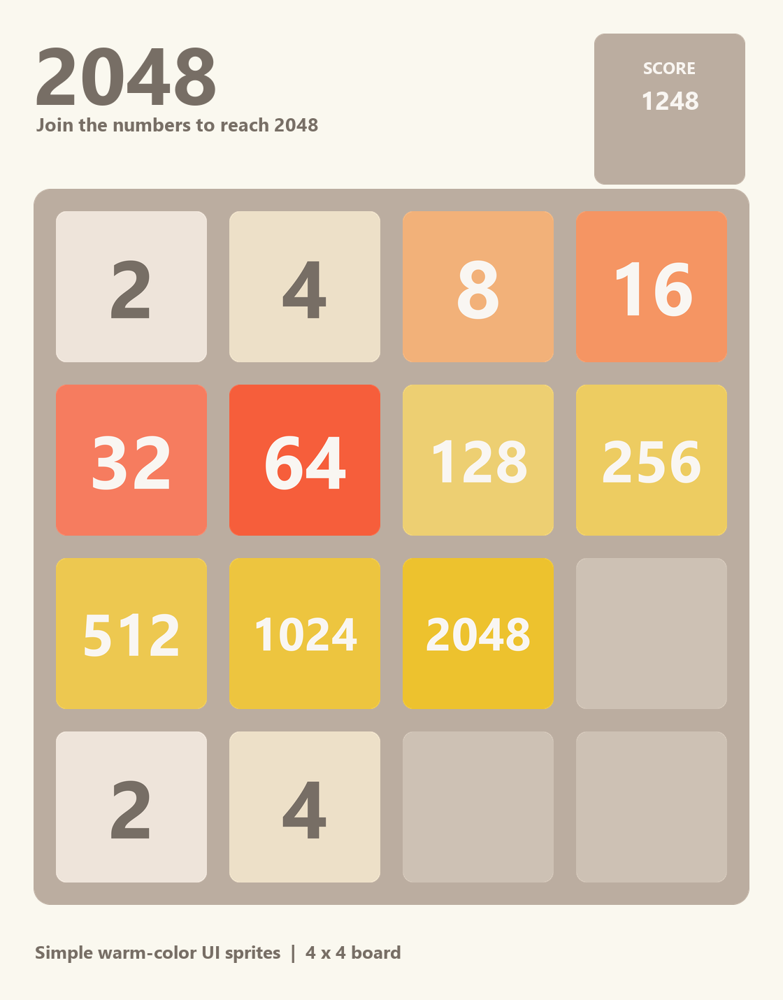

# 2048（Unity 复刻练习）

使用 Unity 2022.3.62f3c1 制作的 4×4 2048 游戏。电脑可用方向键或鼠标拖动，手机可触摸滑动；按 **New Game** 重新开始。



## 打开项目

1. 在 Unity Hub 中添加本仓库目录，使用 **2022.3.62f3c1** 打开。
2. 打开 `Assets/Scenes/PlayScene.unity`，按 Play 试玩。
3. 首次打开会重新生成 `Library`，所需包由 `Packages/manifest.json` 安装。

## 构建

Unity 菜单提供 **2048 → Build → Windows x64** 和 **2048 → Build → Android APK**。默认输出到本地 `Builds/Windows/2048.exe` 与 `Builds/Android/2048.apk`；`Builds` 不上传到 Git。Windows 版本应连同同目录的 `2048_Data`、`UnityPlayer.dll` 等文件一起分发，不能单独复制 exe。

Android 构建需要在 Unity Hub 给当前编辑器安装 **Android Build Support、Android SDK & NDK Tools、OpenJDK**。构建脚本使用 IL2CPP 与 ARM64，输出供本机安装测试的 APK。若将来上架应用商店，还需单独设置包名、签名和商店要求。

可用命令行构建，例如：

```powershell
& 'D:\Unity\2022.3.62f3c1\Editor\Unity.exe' -batchmode -nographics -quit -projectPath 'D:\Unity Programs\2048' -buildTarget StandaloneWindows64 -executeMethod Build2048.BuildWindows -logFile 'D:\Unity Programs\2048\Builds\windows-build.log'
```

同一个项目已在 Unity 编辑器打开时，应在该编辑器的菜单中构建，或关闭编辑器后再运行命令行构建。安卓命令只需把目标改为 `Android`、方法改为 `Build2048.BuildAndroid`。

## 代码入口

- `Assets/Scripts/ItemScripts/ItemMatrix.cs`：棋盘规则、提取非空块、合并、回填、移动记录。
- `Assets/Scripts/GameSettings/GameManager.cs`：一局游戏的状态、分数、随机生成、界面刷新与滑动动画。
- `Assets/Scripts/Input/`：键盘、鼠标和触摸输入。
- `Assets/Scripts/UI/ResponsiveBoardLayout.cs`：横竖屏和安全区域布局。
- `Assets/Editor/Build2048.cs`：构建入口。

项目流程、算法和学习收获见 [项目学习与实现记录](docs/2048项目学习与实现记录.md)。

## 素材与参考

简洁配色的 PNG 素材由仓库内 `ArtSource/generate_simple_2048.py` 生成；资源使用说明在 `ArtSource/使用说明.md`。项目参考了 Dimitris Kanatsios 的 [Unity 2048 教程](https://dgkanatsios.com/2016/01/23/building-the-2048-game-in-unity-via-c-and-visual-studio/)，棋盘处理与动画记录按照本项目的实现重写。当前没有音效。
