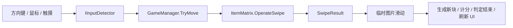

# Unity 4×4 2048 实现案

## 1. 目标与范围

制作一个可在 Windows 电脑与 Android 手机上运行的 4×4 2048 游戏。玩家向上、下、左、右滑动棋盘；相同数值的相邻块在一次操作中合并一次，分数增加合并后的数值；没有可移动方向时结束，出现 2048 时获胜。开始或重开时随机生成两个块。

本项目是学习用复刻。玩法逻辑是完整的单局流程；没有存档、音效、主菜单、撤销和在线排行榜。

## 2. 场景与数据分工

`PlayScene.unity` 包含 Canvas、4×4 格子、分数文本、重开按钮和 EventSystem。每个格子是固定的 UI `Image`，按照“第 0 行在顶部，每行从左到右”的顺序存放在 `GameManager.GOcells` 中，因此索引计算为 `row * 4 + column`。

`ItemMatrix` 保存 `Item[4,4]`，其中 `null` 代表空格。它只处理棋盘规则，不直接移动 UI 对象。`GameManager` 管理分数、游戏状态、生成新方块和刷新 UI。`IInputDetector` 统一输入接口；方向键检测器和滑动检测器分别实现它。

## 3. 一次滑动的规则处理

`ItemMatrix.OperateSwipe(direction)` 对每一行或每一列依次执行三个阶段：

1. **提取**：从本次移动的目标边开始遍历，收集非空 `Item`，同时保存原来的 `(row, column)`。
2. **合并**：顺序处理相邻且数值相同的两个块。两个原块组成一个 `TileGroup`，得到一个数值翻倍的新块；记录新增分数。同一块在本次操作中只合并一次。
3. **回填**：按目标边顺序将结果写回矩阵，其余格子设为 `null`。每个原块都产生一条 `TileMove`，记录旧数值、起点与终点。合并时会有两条移动记录指向同一终点。

滑动前后比较棋盘数值，得到 `SwipeResult.Changed`。若结果没有变化，`GameManager` 不播放动画、不计分，也不生成新方块。这样，规则处理与动画显示互不依赖。

例子：一行 `[2, 0, 2, 4]` 向左滑动会得到 `[4, 4, 0, 0]`，新增分数为 4。两个 2 的移动记录都指向第一格；旧 4 的移动记录指向第二格。`[2, 2, 2, 2]` 向左得到 `[4, 4, 0, 0]`，不会在同一回合继续合成 8。

## 4. 游戏状态与动画时序

`GameManager` 在开局时清空棋盘和分数、将状态设为 `Playing`，生成两个数值为 2 或 4 的方块。每次有效滑动按以下顺序执行：

1. `ItemMatrix` 计算新棋盘，并返回 `SwipeResult`。
2. `GameManager` 将 `isAnimating` 设为真，依据每条 `TileMove` 在 Canvas 下创建一张临时 `Image`。原来的固定格子暂时显示为空图。
3. 协程 `PlaySwipe` 每帧用 `Time.deltaTime` 累加进度，对临时图片的位置做插值。
4. 动画完成后销毁临时图片，再加分、生成一个新块、检查胜负并刷新 16 个固定格子的图片。

动画期间的新输入不会触发第二次棋盘操作。重开时先停止协程并清理临时图片，防止上一局的动画覆盖新局。临时图片放在 Canvas 下，而非 `GridLayoutGroup` 下，避免布局系统覆盖它的位置。

## 5. 输入和多屏幕布局

电脑使用方向键与鼠标拖动。手机读取 `Input.GetTouch(0)` 的开始、结束和取消阶段；滑动检测器根据位移较大的坐标轴判断方向，过滤过短或过久的操作。触摸期间不会再把模拟鼠标事件当作第二次滑动。

`ResponsiveBoardLayout` 读取 `Screen.safeArea`，通过 Canvas 坐标安排棋盘、分数和重开按钮。横屏时棋盘在右、控件在左；竖屏时控件在棋盘上方。棋盘保持正方形，格子大小、间距和边距随棋盘一起缩放。屏幕尺寸或安全区域变化时重新计算布局。

## 6. 构建与发布步骤

项目使用 Unity **2022.3.62f3c1**，且已将 `Assets/Scenes/PlayScene.unity` 加入 Build Settings。

### Windows

在 Unity 菜单点击 `2048 → Build → Windows x64`，生成 `Builds/Windows/2048.exe`。测试方向键、鼠标拖动、分数、合并、胜负和重开。分发时打包整个 `Builds/Windows` 文件夹。

### Android

先在 Unity Hub 确认当前编辑器装有 Android Build Support、SDK/NDK 与 OpenJDK，再点击 `2048 → Build → Android APK`，生成 `Builds/Android/2048.apk`。脚本设置 IL2CPP/ARM64。用真机分别试竖屏与横屏，关注刘海/挖孔安全区域、触摸方向、按钮点击和动画流畅度。

当前 APK 定位为本机测试版本，构建脚本暂用 `com.example.unity2048` 作为包名。若要正式分发，应设置自己的 Android 包名、应用图标、签名密钥与目标 API，并按分发平台的现行要求构建。

## 7. 验收清单

- 四个方向均能移动；行 0 始终是棋盘顶部。
- `2 2 2 2` 一次滑动得到 `4 4`；新合成的块不会同回合再合并。
- 无效方向不生成新块；有效方向动画结束后恰好生成一个新块。
- 合并分数正确；达到 2048 显示胜利；满盘且没有相邻同值块时显示失败。
- 动画中连续输入不会重入；动画中按重开会清理旧动画。
- Windows 方向键/鼠标及 Android 触摸都可操作；横竖屏主要 UI 均在安全区域内。

## 8. 参考与素材

思路参考 [Building the 2048 game in Unity via C#](https://dgkanatsios.com/2016/01/23/building-the-2048-game-in-unity-via-c-and-visual-studio/)。本项目的提取、合并、回填算法及其动画记录按自己的数据结构实现。简洁配色 PNG 由 `ArtSource/generate_simple_2048.py` 生成，使用说明见 `ArtSource/使用说明.md`。
