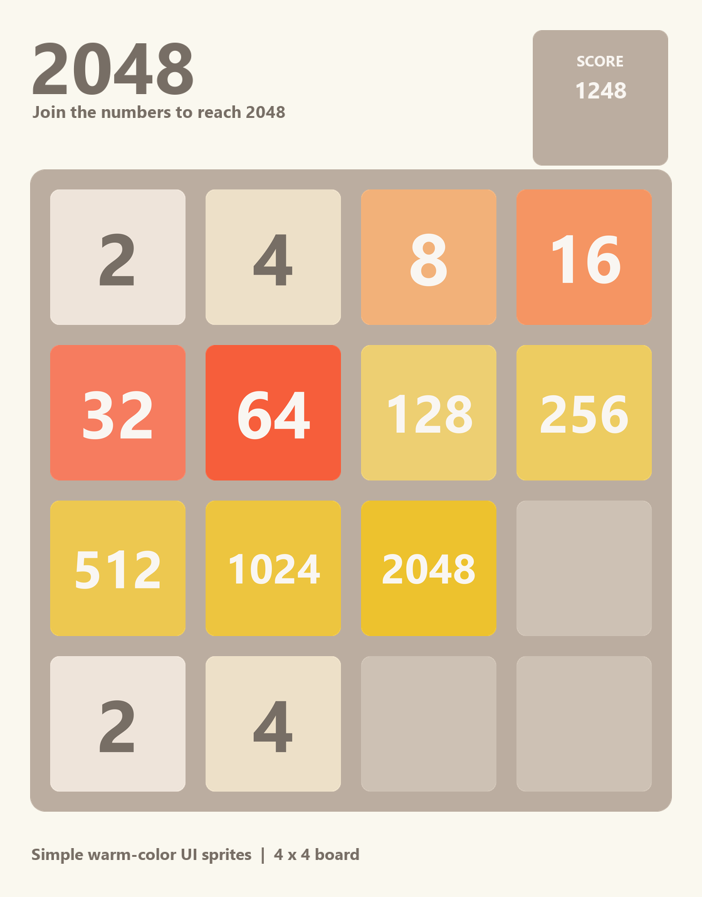

# Unity 4×4 2048：项目学习与实现记录

> 项目版本：Unity 2022.3.62f3c1  
> 项目目标：完成一款可用键盘、鼠标和触摸操作的 4×4 2048，并理解从棋盘规则到界面动画的实现过程。



## 一、项目目标与完成内容

本项目复刻 2048 的基本玩法：玩家选择上、下、左、右方向，方块向目标边移动，相邻且相同的方块合并。合并后的数值计入分数；一次有效移动后随机生成一个新方块。出现 2048 时判定胜利，棋盘填满且无法再合并时判定失败。

目前实现了 4×4 棋盘、开局与重开、分数与胜负判定、方向键与鼠标/触摸滑动、方块移动动画，以及横竖屏的界面布局。项目也提供 Windows 和 Android 的构建入口。存档、音效、撤销和排行榜仍属于后续扩展。

## 二、我的实现过程

| 阶段 | 完成的工作 | 当时的关键问题 |
| --- | --- | --- |
| 1. 建立数据模型 | 用 `Globals` 定义棋盘尺寸，用 `Item` 表示一个方块，用 `ItemMatrix` 保存 4×4 棋盘。 | 约定第 0 行在棋盘顶部，`null` 表示空格，避免逻辑坐标和 UI 顺序不一致。 |
| 2. 实现移动规则 | 将每个方向的操作统一为“提取非空块 → 合并 → 回填矩阵”。 | 不再为四个方向各写一套完整合并规则，只改变读取和写回的顺序。 |
| 3. 接入输入 | 使用 `IInputDetector` 统一方向输入，分别处理键盘方向键、鼠标拖动和手机触摸。 | 检测器只报告方向；是否允许移动由游戏管理逻辑决定。 |
| 4. 搭建画面 | 制作简单配色的美术素材和方块 Prefab，在场景中放置 16 个固定 UI 格子。 | 用矩阵坐标 `row * 4 + column` 映射到格子数组。 |
| 5. 串联游戏流程 | 在 `GameManager` 中实现初始化、生成新块、分数、胜负判定和 UI 刷新。 | 只有棋盘实际变化时才生成新方块。 |
| 6. 为动画补充数据 | 重构 `ItemMatrix`，为每个原方块记录旧数值、起点和终点。 | 合并后的一个结果块需要保留两个来源块的运动信息。 |
| 7. 实现滑动动画 | 通过协程逐帧移动临时 UI 图片，动画结束后显示新棋盘。 | 动画期间锁定输入；重开时停止协程并清理临时图片。 |
| 8. 适配与构建 | 根据屏幕安全区域调整棋盘和控件布局，配置 Windows 与 Android 构建入口。 | 区分游戏运行文件与构建时生成的调试资料。 |

最初参考了 [Unity 2048 教程](https://dgkanatsios.com/2016/01/23/building-the-2048-game-in-unity-via-c-and-visual-studio/) 的整体思路。实际编写棋盘规则时，我改用自己更容易理解的逐行、逐列处理流程；需要动画时，再给这条流程补上来源与目标信息。

## 三、项目结构与职责

```text
Assets/
├─ Scenes/PlayScene.unity              游戏场景与 UI
├─ Scripts/
│  ├─ GameSettings/
│  │  ├─ Globals.cs                    棋盘行列数
│  │  └─ GameManager.cs                一局游戏的流程、分数、胜负和动画
│  ├─ Input/
│  │  ├─ IInputDetector.cs              输入接口与方向定义
│  │  ├─ ArrowKeysDetector.cs           键盘方向键
│  │  └─ SwipeDetector.cs              鼠标与触摸滑动
│  ├─ ItemScripts/
│  │  ├─ Item.cs                       方块数据
│  │  └─ ItemMatrix.cs                 棋盘规则与移动记录
│  └─ UI/ResponsiveBoardLayout.cs       横竖屏和安全区域布局
├─ Art/2048Simple/                     方块、棋盘和按钮图片
├─ Prefab/                             各数值方块的图片模板
└─ Editor/Build2048.cs                 Windows 和 Android 构建菜单
```

`ItemMatrix` 管理**规则数据**，不负责移动场景中的 GameObject。场景中的 16 个 `Image` 是固定位置的格子；`GameManager` 根据矩阵的数值替换它们的 Sprite。Prefab 在当前方案中主要作为不同数值 Sprite 的模板。

## 四、核心方案：一次滑动如何完成

### 1. 提取、合并、回填

无论向哪个方向移动，都先从该方向的目标边读取一行或一列，跳过空格，再按顺序合并相邻且相同的方块，最后把结果写回目标边。不同方向只影响读取和回填的坐标顺序。

```csharp
List<ExtractedTile> extracted = ExtractArray(direction, arraySize, i);
List<TileGroup> merged = ExecuteMerge(extracted);
List<TileMove> moves = RecoverArrayToMatrix(merged, direction, arraySize, i);
result.Moves.AddRange(moves);
```

例如，`[2, 0, 2, 4]` 向左移动后成为 `[4, 4, 0, 0]`，增加 4 分；`[2, 2, 2, 2]` 向左移动后成为 `[4, 4, 0, 0]`，本回合不会继续合成 8。回填后比较移动前后的棋盘数值，生成 `SwipeResult.Changed`；无变化时不播放动画，也不生成新块。

### 2. 为动画保留来源信息

这次重构最重要的认识是：**最终棋盘只说明结果，不能单独还原每块的运动过程**。因此我把中间信息也作为规则处理的输出：

| 数据类型 | 记录的内容 | 作用 |
| --- | --- | --- |
| `ExtractedTile` | 原 `Item` 和提取时的原坐标 `From` | 防止回填后丢失起点。 |
| `TileGroup` | 结果方块 `ResultItem` 和来源列表 `Sources` | 普通移动有 1 个来源；合并有 2 个来源。 |
| `TileMove` | 原方块数值、起点 `From`、终点 `To` | 告诉画面层每张临时图片如何移动。 |
| `SwipeResult` | 是否变化、增加的分数、全部 `TileMove` | 将一次移动的结果交给 `GameManager`。 |

合并时，两条 `TileMove` 可以指向同一个终点，而 `TileMove.Value` 仍保存**合并前**的数值。这样动画显示的是两个旧方块滑向目标格；合并后的新数值在动画结束后由固定格子显示。

### 3. 游戏流程与动画时序

一次有效滑动按以下顺序执行：

1. `GameManager.TryMove` 调用 `ItemMatrix.OperateSwipe`，取得新棋盘与 `SwipeResult`。
2. 根据 `TileMove` 在 Canvas 下创建临时 `Image`，将固定格子暂时显示为空图。临时图片不能放在 `GridLayoutGroup` 下，否则布局系统会覆盖它的位置。
3. `PlaySwipe` 协程每帧累加 `Time.deltaTime`，用 `Vector3.Lerp` 计算临时图片的位置。
4. 动画结束后清理临时图片，累加分数，随机生成一个新块，检查胜负并刷新固定格子。

`isAnimating` 防止动画未结束时再次处理输入。重开会先停止旧协程并清理临时图片，再初始化新棋盘。胜负状态为 `Playing`、`Victory`、`Defeat`；开局生成两个随机块，之后每次**有效**移动生成一个。

### 4. 输入与界面适配

`IInputDetector.DetectInputDirection()` 返回 `SwipeDirection?`：有方向时返回枚举值，没有有效输入时返回 `null`。键盘检测器与滑动检测器使用同一接口。滑动检测器通过起止位置和时间过滤误触，取位移较大的坐标轴判断方向；手机触摸优先于模拟鼠标事件处理。

`ResponsiveBoardLayout` 读取 `Screen.safeArea`。横屏时棋盘和控件左右排列，竖屏时控件位于棋盘上方；棋盘始终保持正方形，格子尺寸和间距随之调整。不同尺寸的实际观感仍应以电脑窗口和手机真机测试为准。

## 五、我在项目中的收获

1. **`readonly` 关键字。** 实例只读字段可在声明处或该类的实例构造函数中赋值；`static readonly` 字段可在声明处或静态构造函数中赋值。它限制的是字段之后不能再被重新赋值。项目中的 `Globals.Rows`、`Globals.Columns` 是静态只读字段。
2. **`out`关键字。** 方法必须在返回前给 `out` 参数赋值；赋值之后也可以在方法内部读取它。`GetEmptyPosition(out int row, out int column)` 因而能一次带回两个坐标。
3. **接口interface与具体输入方式的分工。** `IInputDetector` 是契约，不是“接口类”；调用方依赖统一的检测方法，键盘和滑动组件各自决定怎样产生方向。可空返回值把“本帧没有有效输入”表达得很明确。
4. 序列化与**Inspector 属性。** `[SerializeField]` 让私有实例字段可以在 Inspector 中配置；`[Header]` 是分组标题，若要给字段写说明可用 `[Tooltip]`。静态字段不会因为这些属性而变成普通的 Inspector 配置项。
5. **学会为下一步需求保留数据。** 最初的“提取 → 合并 → 回填”足以计算最终棋盘，但动画还需要来源信息。将每一步的中间结果明确建模后，逻辑结果、分数与动画路径可以一起返回。
6. **协程Coroutine的工作方式。** `IEnumerator` 方法通过 `yield return null` 暂停到下一帧，`StartCoroutine` 驱动它继续执行；这仍在 Unity 主线程运行，并不是开启一个后台线程。用 `Time.deltaTime` 推进进度可避免动画速度完全依赖帧率。

这次练习让我更重视先确定**数据与规则的边界**，再处理显示。对原教程中不够直观的部分，我尝试用自己的数据结构重新表达，遇到动画需求时也能继续扩展原有流程。

## 六、验证要点与后续改进

### 验证要点

- 四个方向都能正确压缩和合并；第 0 行始终对应棋盘顶部。
- `2, 2, 2, 2` 一次移动得到两个 `4`；无效移动不加分、不生成新块。
- 合并分数、胜利与失败判定正确；连续输入不会打断动画，动画中重开不会留下旧图片。
- 在电脑上检查方向键与鼠标，在 Android 真机上检查触摸、按钮、横竖屏和安全区域。

### 可改进处（按优先级）

1. **拆分 `GameManager` 的职责。** 当前它同时处理游戏状态、分数、UI 刷新和动画。后续可逐步提取棋盘显示和动画组件，让规则与画面之间的调用关系更清楚；不必为了这个小项目一次性引入过多层级。
2. **整理 `ItemMatrix` 的类型与方向处理。** 将 `CellPosition`、`TileMove`、`SwipeResult` 等移到合适的独立文件，并抽出方向到坐标的转换，减少四个方向中重复的回填代码。
3. **统一配置边界。** 行列数等固定规则集中管理；滑动时长、输入距离等需要调试的值保留为可配置字段。清理不再使用的 `using`、历史注释代码与旧类引用。
4. **补充规则和交互测试。** 优先覆盖连续合并、无效滑动、满盘判负、动画中重开，以及不同屏幕比例下的 UI；这些用例比单纯重复实现代码更能发现错误。
5. **增强完成度。** 可加入音效、合并与生成反馈、最高分保存、撤销或继续游戏选项。若准备正式发布，再处理应用标识、签名、图标和版本管理。

## 七、构建与项目整理

场景 `PlayScene.unity` 已加入 Build Settings。Windows 构建需要连同运行所需的输出文件夹一起分享；Android 安装测试通常分享 APK 即可，`*_BurstDebugInformation_DoNotShip` 属于开发调试资料。Git 仓库通过 `.gitignore` 排除 `Library`、`Temp`、`Builds` 等生成目录，保留 `Assets`、`Packages`、`ProjectSettings` 与文档，便于重新打开项目。

图片素材由 `ArtSource/generate_simple_2048.py` 生成，详情见 [素材使用说明](../ArtSource/使用说明.md)。本文将学习笔记与实现案合并整理为一份项目记录。
